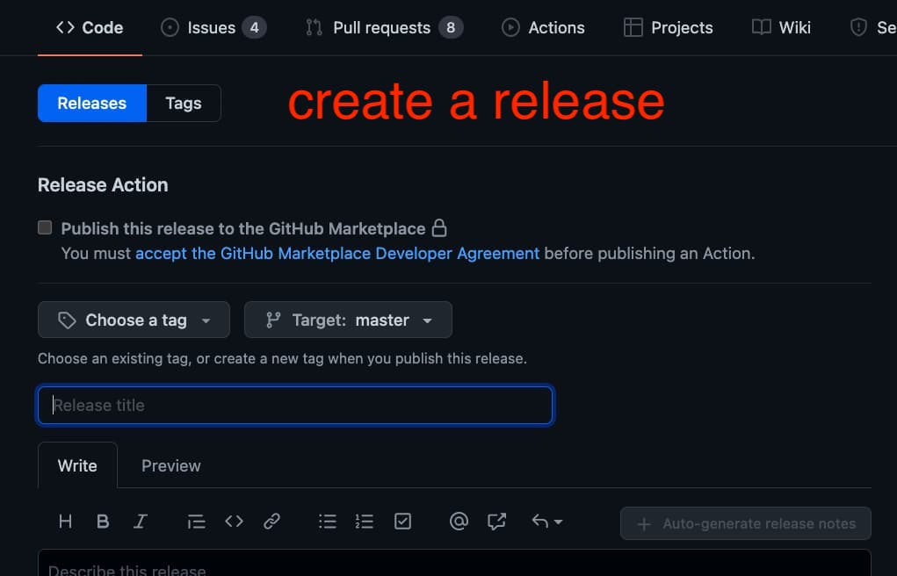
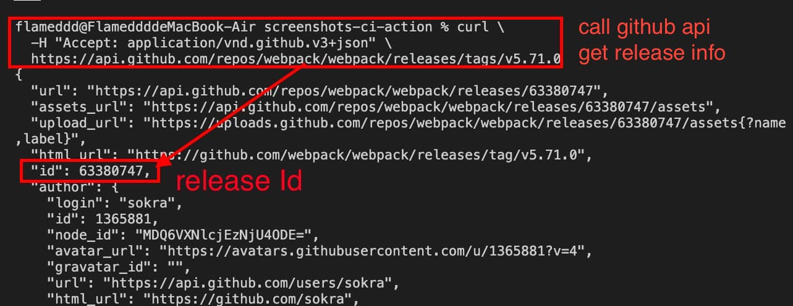
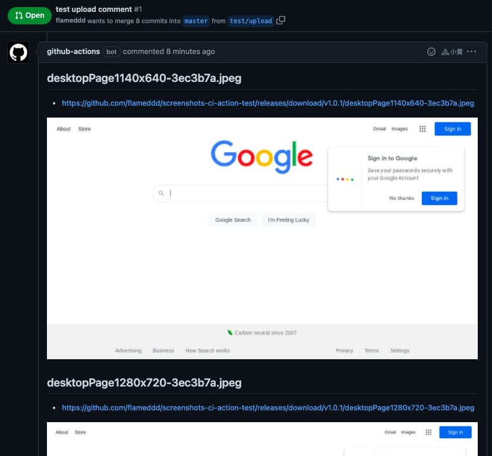

# Post the screenshots to a pull request comment

[Back to the README](README.md)

On a `pull_request` workflow the action can upload every screenshot to a
**GitHub release** and post them as a comment on the pull request. By default
the comment has one collapsed section per capture and is edited in place on
every push, see [PR comments](README.md#pr-comments) for all the options.

How it works:

1. The images are uploaded as **assets of a release** you name with
   `release-id` (the action does not create the release).
2. The comment embeds the download URLs of those assets.
3. On the next push the same comment is edited, the new images are added as new
   assets.

You need three things: a release (and its id), a `pull_request` trigger and a
token with the right permissions.

## 1. Create a release and find its id

Create a release **once** and use it for all pull requests: a long-lived
**pre-release** that is never meant to be shipped. It collects the screenshots
of every run, so nothing has to be created per pull request or per push.

```shell
# once: a pre-release that is not "latest" and has a tag nothing else uses
gh release create ci-screenshots --prerelease --latest=false \
  --title 'CI screenshots' --notes 'Screenshots uploaded by screenshots-ci-action'

# its id, the value for the release-id input
gh api repos/OWNER/REPO/releases/tags/ci-screenshots --jq .id
```

(Replace `OWNER/REPO`. Without the CLI: create the release on the repository's
Releases page, tick "Set as a pre-release", then
`curl -H "Accept: application/vnd.github+json" https://api.github.com/repos/OWNER/REPO/releases/tags/ci-screenshots`
and read the `id`, the number, not the `node_id`.)

Good to know:

- **Use a release that is published.** The images in the comment are the
  download URLs of the assets, and a draft release's assets are not publicly
  reachable. A pre-release is published and is fine.
- **Pick a tag name that does not collide** with your real releases and
  release tooling. `ci-screenshots` (no `v` prefix) is ignored by
  [release-please](https://github.com/googleapis/release-please) style
  versioning, and a pre-release is never marked as "latest" with
  `--latest=false`. This repository does exactly that for its own CI, see
  [README.ci.md](README.ci.md#the-ci-pre-release).
- Any other existing release works too, but its assets list gets cluttered.
- `release-id` is looked up in the repository the workflow runs in, so a
  release cannot be shared between repositories.




### Asset names and the limit of 1000 assets

Every run uploads each screenshot as a new asset named
`<ISO timestamp>-<file name>`, for example
`2026-10-16T14.51.09.683Z-iPhone_13-7844a0e.jpeg` (GitHub turns the `:` of the
timestamp into a `.`). All files of one run share the timestamp, and runs never
overwrite each other, so a re-run or another call of the action cannot collide.

The price is that the assets **accumulate**: one run with the 7 desktop sizes
and 2 devices adds 9, and **GitHub allows at most 1000 assets per release**.
Once the release is full GitHub rejects further uploads, the log shows
`Failed to upload` and no comment is posted. Plan for pruning, for
example a scheduled workflow (or a step at the end of your job) that deletes
old assets of that one release:

```yaml
name: prune screenshot assets
on:
  schedule:
    - cron: '17 3 * * 0'
  workflow_dispatch:

permissions:
  contents: write

jobs:
  prune:
    runs-on: ubuntu-latest
    env:
      GH_TOKEN: ${{ github.token }}
      RELEASE_ID: '63601424' # your release-id
    steps:
      - name: Delete assets older than 30 days
        run: |
          cutoff=$(date -u -d '30 days ago' +%Y-%m-%dT%H:%M:%SZ)
          gh api --paginate "repos/$GITHUB_REPOSITORY/releases/$RELEASE_ID/assets" \
            --jq '.[] | [.id, .created_at] | @tsv' |
          while IFS=$'\t' read -r id created; do
            if [[ "$created" < "$cutoff" ]]; then
              gh api -X DELETE "repos/$GITHUB_REPOSITORY/releases/assets/$id"
            fi
          done
```

Deleting an asset breaks the images of old comments that still point to it, so
choose a retention that is longer than your pull requests live. This
repository's own CI uses a variant that only prunes once the release holds more
than 600 assets, see [README.ci.md](README.ci.md#pruning).

## 2. The workflow

```yaml
name: screenshots ci actions
on:
  pull_request:
    types: [ opened, synchronize, reopened ]

permissions:
  contents: write       # upload the screenshots as release assets
  pull-requests: write  # post and edit the comment

jobs:
  screenshots:
    runs-on: ubuntu-latest
    steps:
    - uses: actions/checkout@v7
    - name: screenshots-ci-action
      uses: Primajin/screenshots-ci-action@v4
      with:
        url: https://www.google.com/
        devices: iPhone 6,iPhone 6 landscape
        release-id: 63601424
      env:
        GITHUB_TOKEN: ${{ secrets.GITHUB_TOKEN }}
    - uses: actions/upload-artifact@v7
      with:
        path: screenshots
        name: Download-screenshots
```

- `GITHUB_TOKEN` as an **env** of the step is required for the upload and the
  comment. The action does not read it from anywhere else. GitHub creates the
  token for every run, see
  [Automatic token authentication](https://docs.github.com/en/actions/security-guides/automatic-token-authentication).
- **Permissions:** uploading a release asset needs `contents: write`, posting
  and editing the comment needs `pull-requests: write`. If your organisation
  or repository defaults the token to read-only, set both in the workflow (or
  job) as above. A workflow without a `permissions` block gets the repository's
  default.
- The trigger must be `pull_request`: the action takes the pull request number
  from the event. Without a pull request (a `push`, `workflow_dispatch`) nothing
  is posted. The `types` shown are the default ones plus `reopened`.
- Without `release-id` nothing is uploaded or posted, and the log says so.
- To upload without posting (for example from a `push` workflow), set
  `comment: false` together with `release-id`.



## 3. Pull requests from forks and Dependabot

For a pull request from a fork (and for Dependabot) GitHub gives the workflow a
**read-only** `GITHUB_TOKEN` and no secrets, whatever the `permissions` block
says. The upload then fails: each file logs `Failed to upload` and no comment
is posted, but the action itself does **not** fail and the screenshots are
still in `screenshots/` for `actions/upload-artifact`.

Options: skip the release step for these pull requests, for example
`if: github.event.pull_request.head.repo.full_name == github.repository`
on the job (this repository does that for its own CI), or upload the screenshots
as an artifact only. Switching to `pull_request_target` would give the fork a
write token; do not combine it with checking out and running the fork's code.

Private repositories: the image URLs of a release are only publicly reachable
when the repository is public. Posting to the pull request of a private
repository has not been tested by this project.

## 4. Customise the comment

Layout (`details`, `inline`, `links`), which sections start open, grouping,
image width and height, headline, tag, footer, update in place or a new comment
per push: see [PR comments](README.md#pr-comments) in the README.
