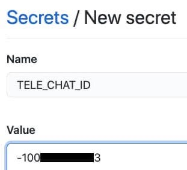
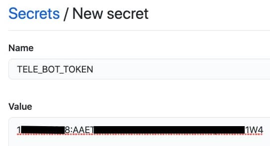
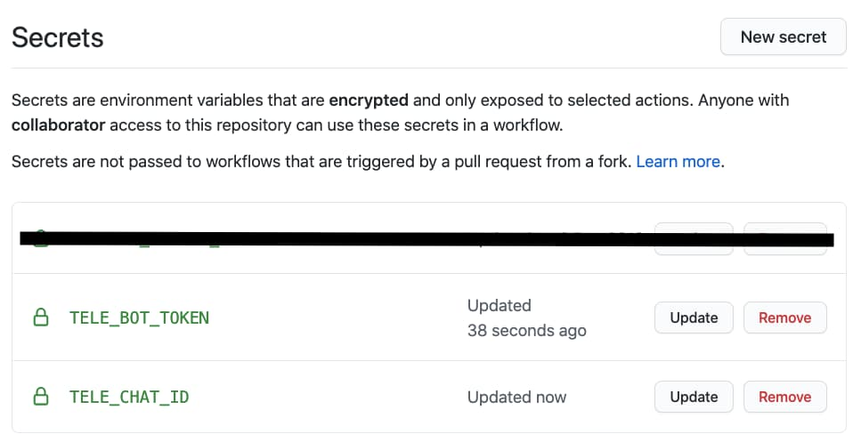
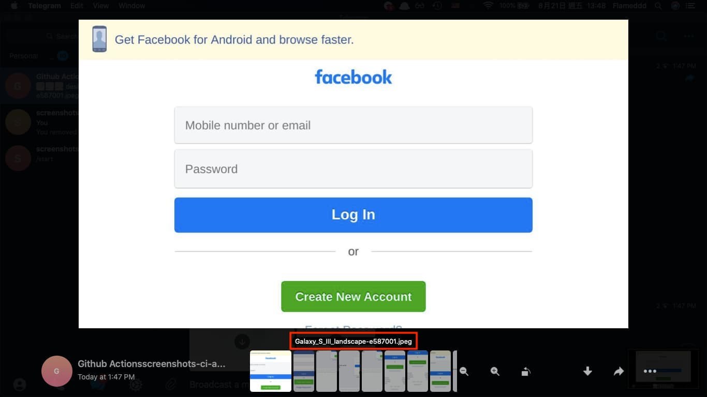
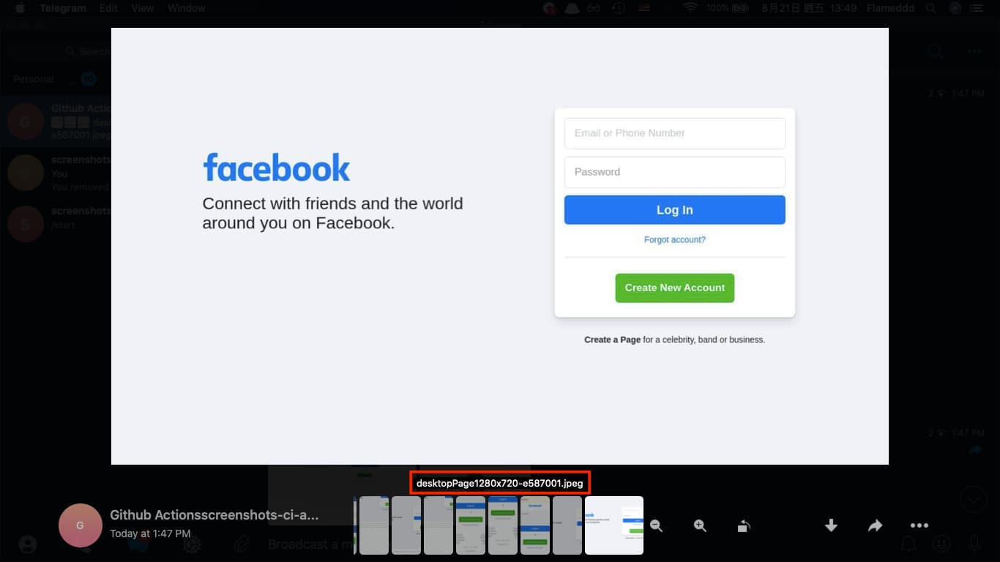
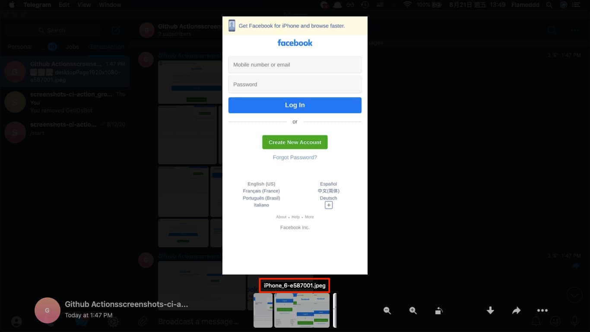

# Send the screenshots to Telegram

[Back to the README](README.md)

When the environment variables `TELE_CHAT_ID` and `TELE_BOT_TOKEN` are both set
on the action step, every file in the `screenshots/` directory is sent to that
Telegram chat after the capture. Nothing else is needed: no `release-id`, no
`GITHUB_TOKEN`. It can be combined with the [PR comment](README.PR.md) and with
`actions/upload-artifact`.

## Prerequisites

1. A bot token
    - how to create a bot and get its token: [Telegram bot tutorial](https://core.telegram.org/bots/tutorial) (talk to [@BotFather](https://t.me/BotFather))
2. A chat id: a user, a group or a channel
    - how to get a group id: https://stackoverflow.com/a/38388851
    - how to get a channel id: https://gist.github.com/mraaroncruz/e76d19f7d61d59419002db54030ebe35#gistcomment-3276103
    - **private channel or group**: add the **bot** and make sure it has **permission to post**.

## 1. Set the repository secrets

Keep the chat id and the bot token in repository secrets, never in the
workflow file (Settings > Secrets and variables > Actions, see
[Using secrets in GitHub Actions](https://docs.github.com/en/actions/security-guides/using-secrets-in-github-actions)):

- the group, channel or user id as `TELE_CHAT_ID`
- the bot token as `TELE_BOT_TOKEN`





## 2. Pass them to the action

```yaml
env:
  TELE_CHAT_ID: ${{ secrets.TELE_CHAT_ID }}
  TELE_BOT_TOKEN: ${{ secrets.TELE_BOT_TOKEN }}
```

Full example:

```yaml
name: screenshots ci actions
on:
  push:
    branches:
    - main

permissions:
  contents: read

jobs:
  screenshots:
    runs-on: ubuntu-latest
    steps:
    - uses: actions/checkout@v7
    - name: screenshots-ci-action
      uses: Primajin/screenshots-ci-action@v4
      with:
        url: https://github.com
        devices: iPhone 6,iPhone 6 landscape
        no-desktop: true
      env:
        TELE_CHAT_ID: ${{ secrets.TELE_CHAT_ID }}
        TELE_BOT_TOKEN: ${{ secrets.TELE_BOT_TOKEN }}
```






## How the files are sent

The action calls the [Telegram Bot API](https://core.telegram.org/bots/api)
directly with the `fetch` of Node 24 (`sendPhoto` and `sendMediaGroup`, a
multipart upload). There is no Telegram library and no extra dependency.

| Files in `screenshots/` | What is sent |
| --- | --- |
| 1 | a single photo (`sendPhoto`) |
| 2 to 10 | one album (`sendMediaGroup`) |
| more than 10 | several albums of up to 10 photos each, one after the other, with a 2 second pause between them so Telegram's rate limit is not hit |

- An album needs 2 to 10 items. If a single file would be left over (11 files
  would be 10 + 1), it takes one file from the previous album: 11 files are
  sent as 9 + 2, 21 files as 10 + 9 + 2.
- Every photo has its **file name as the caption**, so you can tell the
  desktop sizes and devices apart.
- Messages are sent **silently** (`disable_notification`).
- The action writes `.jpeg` (default) or `.png` files (`type` input) and sends
  them as photos. Telegram recompresses photos, so the images in the chat look
  a little softer than the files in the artifact. They are not sent as
  documents.
- Every file of the `screenshots/` directory is sent, including files that an
  earlier step wrote there. A tall page that was captured in parts
  (`-part1`, `-part2`, ...) is sent part by part.
- A failure (wrong token, unknown chat, the bot is not allowed to post, a
  rejected photo) is **logged and does not fail the action**. The error message
  never contains the bot token.
- Secrets are not available to workflows of pull requests from forks, so
  nothing is sent there.

### Telegram's limits for photos

The Bot API documents these limits for photos: at most 10 MB, width plus height
at most 10 000 pixels, and a width to height ratio of at most 20. They are
Telegram's, not the action's, and have not been tested by this project. A tall
full page capture is cut into parts of up to 16 000 pixels (see
[Tall pages](README.md#tall-pages)), so a part can be too tall for Telegram. If
a photo is rejected, set `max-image-height` low enough that width plus height
stays below 10 000 (for example `8000` for an emulated phone), or use the
[PR comment](README.PR.md) or an artifact for tall pages.
