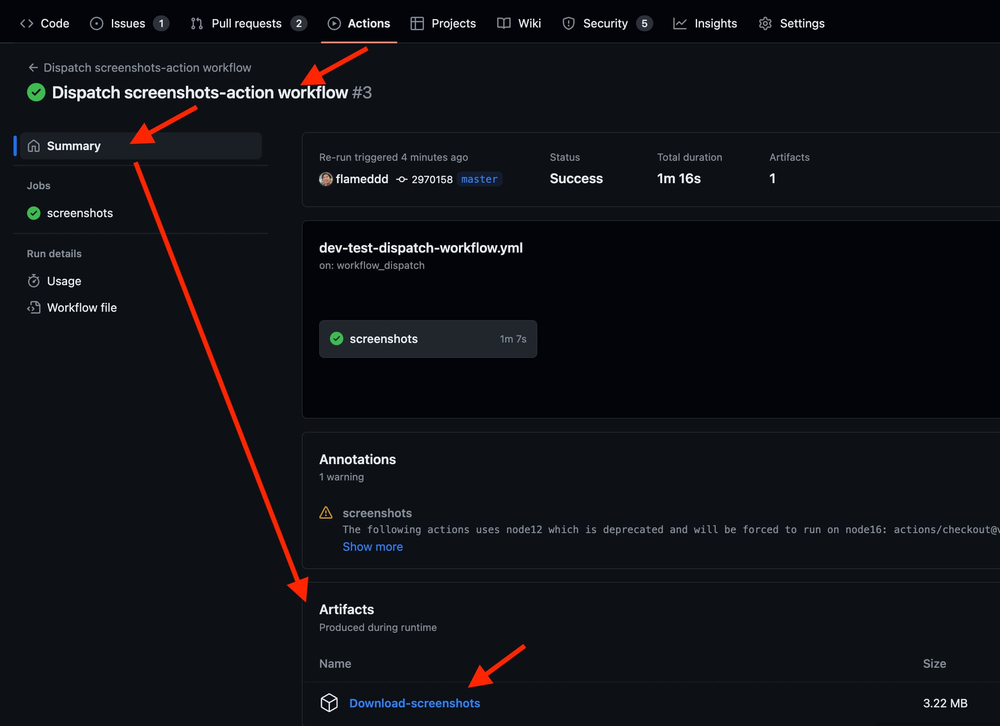
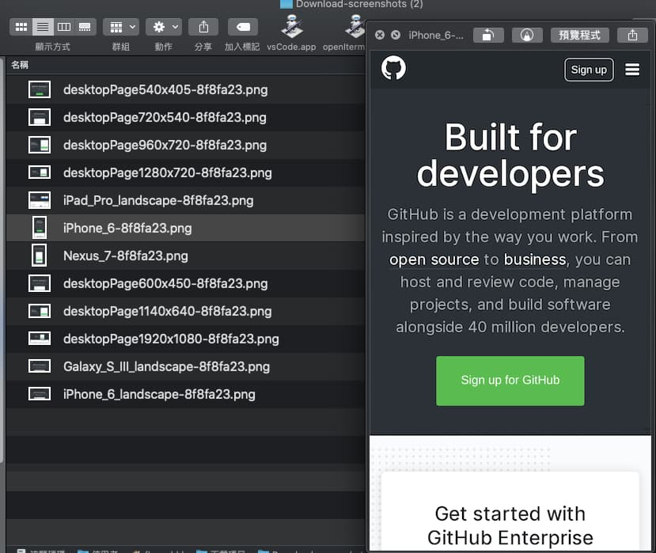
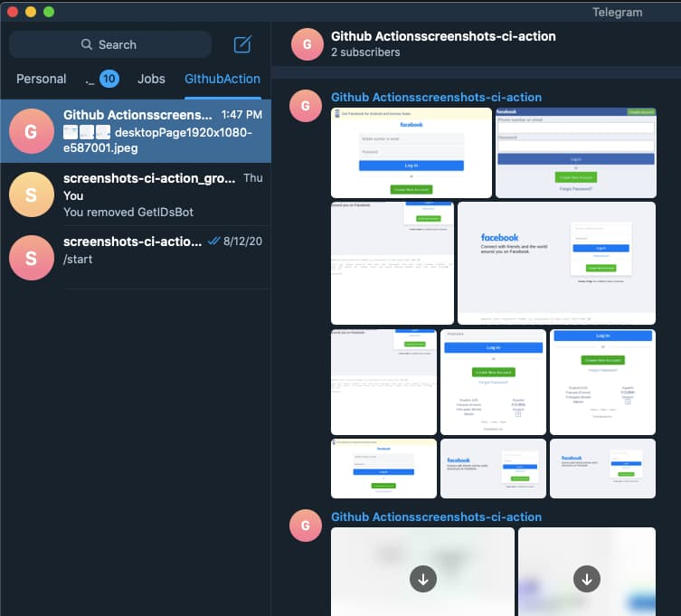
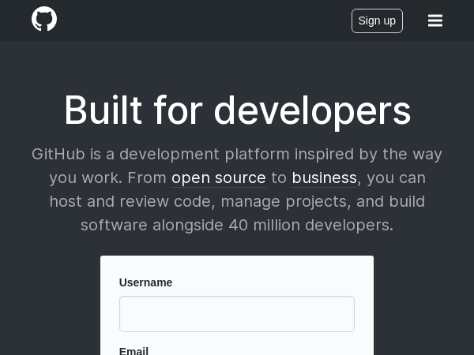
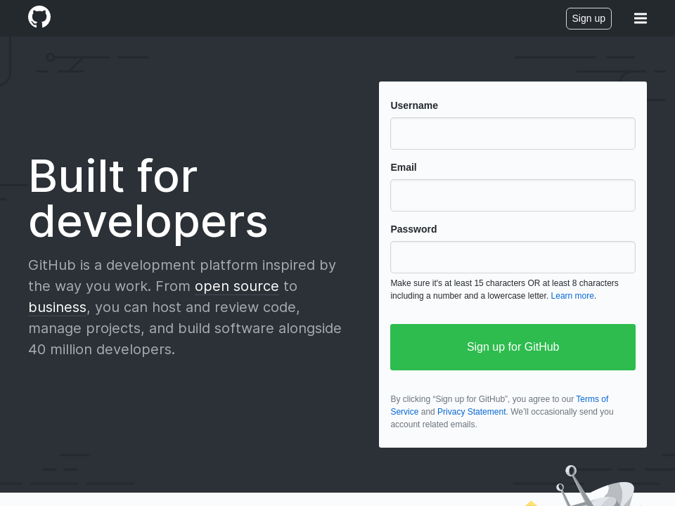
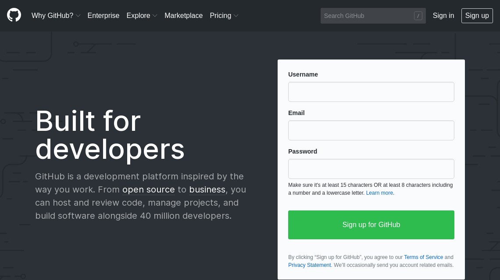
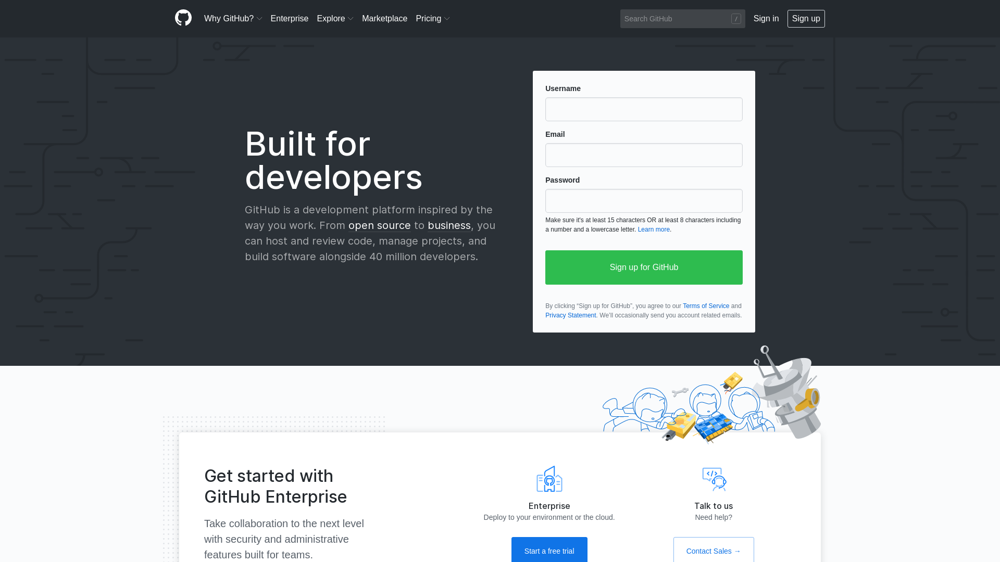
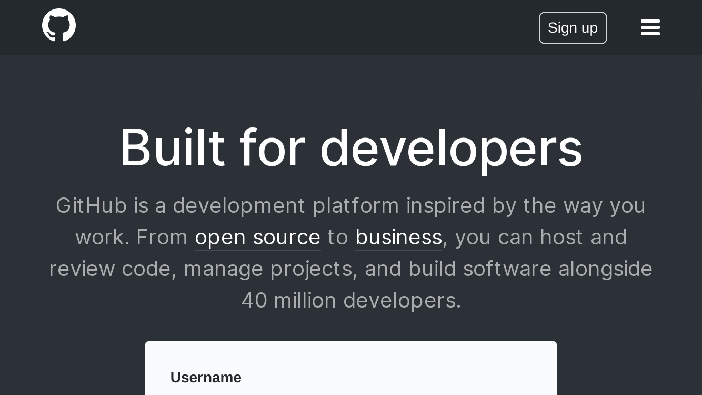
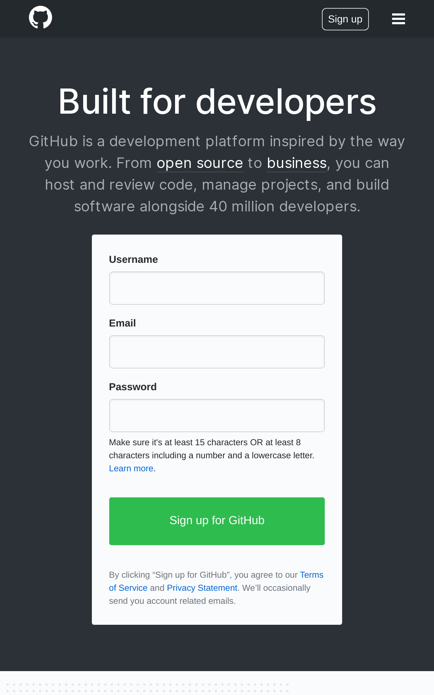

# Multi-Device Website Screenshots CI

Capture screenshots of any website — desktop **and** dozens of emulated mobile
devices — right inside your GitHub Actions workflow. Save them as build
artifacts, post them straight into a pull-request comment, or send them to a
Telegram chat.

[](https://github.com/Primajin/screenshots-ci-action/releases)
[](action.yml)
[](https://playwright.dev/)
[](LICENSE)

> **A maintained, modernized fork** of
> [`flameddd/screenshots-ci-action`](https://github.com/flameddd/screenshots-ci-action)
> (last released 2022). If you're weighing the two, here's what this fork brings:
>
> - 🐛 **`fullPage: false` actually works.** The original bundles an old
>   Puppeteer 14, which ignored `fullPage: false` for emulated mobile devices
>   and captured the whole scrollable page anyway (a single iPad Pro shot came
>   out ~25 000 px tall). This fork runs on **Playwright** (Chromium), so
>   viewport screenshots behave as documented.
> - 🟢 **Current runtime.** A composite action that installs its own
>   dependencies and Chromium on **Node 24**; the original still targets the
>   end-of-life `node16`.
> - 📱 **Up-to-date device list** via Playwright's built-in device descriptors.
> - 🚀 **Actively released** with
>   [release-please](https://github.com/googleapis/release-please) — pin a stable
>   major with `Primajin/screenshots-ci-action@v3`.
>
> Same inputs and outputs as the original, so it's a drop-in replacement:
> just swap `flameddd/screenshots-ci-action@master` for
> `Primajin/screenshots-ci-action@v3`.

## Parameters
| Name(type) | required(default) | Description |
| ------------- | ------------- | ------------- |
| `url`(string) | **required**(`""`) | The target website's URL to generate screenshots |
| `devices`(string) | optional(`""`) | Specific mobile devices to generate screenshots. **Use comma(`,`) to separate devices name.** Device name list in below. |
| `noDesktop`(boolean) | optional(`false`) | Set `true` if not require to get desktop viewpoint screenshots. |
| `fullPage`(boolean) | optional(`false`) | Set `true`, takes a screenshot of the full scrollable page. |
| `noCommitHashFileName`(boolean) | optional(`false`) | Set `true`, the filename would not have commit hash. |
| `type`(string) | optional(`jpeg`) | Specify screenshot type, can be either `jpeg` or `png`. |
| `waitUntil`(string) | optional(`networkidle`) | When to consider navigation succeeded (Playwright values). <br> - `load`: consider navigation to be finished when the load event is fired.<br> - `domcontentloaded`: consider navigation to be finished when the DOMContentLoaded event is fired.<br> - `networkidle`: consider navigation to be finished when there are no network connections for at least `500` ms.<br> - `commit`: consider navigation to be finished when the network response is received and the document started loading. <br><br> The legacy Puppeteer values `networkidle0` and `networkidle2` are still accepted and both map to `networkidle`. Consider `load` or `domcontentloaded` when the target website has **long polling requests**, since `networkidle` never settles there.|
| `waitForSelector`(string) | optional(`''`) | Wait for the **selector** to be attached to the DOM (Playwright state `attached`). If the **selector** doesn't appear after the `waitForSelectorTimeout` of waiting, it will take screenshots immediately. <br> See [README.waitForSelector](/README.waitForSelector.md) for example |
| `waitForSelectorTimeout`(number) | optional(`30000`) | **WaitForSelector Options:** <br> Maximum time to wait in milliseconds. Pass `0` to disable timeout. <br> - `30000` means 30 seconds |
| `waitForSelectorVisible`(boolean) | optional(`false`) | **WaitForSelector Options:** <br> Wait for the selected element to be present in DOM and to be visible (Playwright state `visible`), i.e. to not have `display: none` or `visibility: hidden` CSS properties. |
| `waitForSelectorHidden`(boolean) | optional(`false`) | **WaitForSelector Options:** <br> Wait for the selected element to not be found in the DOM or to be hidden (Playwright state `hidden`), i.e. have `display: none` or `visibility: hidden` CSS properties. |
| `releaseId`(string) | optional(`"`) | Github Release Id, it's required to upload screenshots to PR comment. see [README.PR](/README.PR.md) for more detail |

## Envs
| Name(type) | required(default) | Description |
| ------------- | ------------- | ------------- |
| `TELE_CHAT_ID`(string) | optional(`""`) | Integration with **Telegram**. `screenshots-ci-action` will send screenshots to telegram. see [README.Telegram](/README.Telegram.md) for setting detail. |
| `TELE_BOT_TOKEN`(string) | optional(`""`) | Integration with **Telegram**. `screenshots-ci-action` will send screenshots to telegram. see [README.Telegram](/README.Telegram.md) for setting detail. |
| `GITHUB_TOKEN`(string) | optional(`""`) | Github Actions Tokens, it's required to upload screenshots to PR comment. See [README.PR](/README.PR.md) for more detail |

## Output screenshots
There are **3** different way to output files
1. Upload to **Actions Artifacts**
2. Send message to **Telegram** chat
3. Comment in **PR**

More full example in below

# Example 1
About this example:
- screenshot desktop and few specific devices
- Upload screenshots to **Actions Artifacts**

How to create new workflow
1. At the root of your repository, create a directory named `.github/workflows` to store your workflow files.
2. In `.github/workflows`, add a `.yml` or `.yaml` file for your workflow. For example, `.github/workflows/screenshots-workflow.yml`.

More workflow info:
- https://help.github.com/en/actions/configuring-and-managing-workflows/configuring-a-workflow

```yaml
name: screenshots ci actions
on:
  push:
    branches:
    - master # Trigger flow when something pushed to master branch

jobs:
  screenshots:
    runs-on: ubuntu-latest
    steps:
    - uses: actions/checkout@v4
    - name: screenshots-ci-action
      uses: Primajin/screenshots-ci-action@v3
      with:
        url: https://github.com
        devices: iPhone 6,iPhone 6 landscape,Nexus 7,iPad Pro 11,Galaxy S III landscape,iPad Pro 11 landscape
    - uses: actions/upload-artifact@v4 # Uplaod screenshots to Actions Artifacts via actions/upload-artifact@v4
      with:
        path: screenshots
        name: Download-screenshots
```

# Example 2(screenshot iphone 6, without desktop)

```yaml
name: screenshots ci actions
on:
  push:
    branches:
    - master

jobs:
  screenshots:
    runs-on: ubuntu-latest
    steps:
    - uses: actions/checkout@v4
    - name: screenshots-ci-action
      uses: Primajin/screenshots-ci-action@v3
      with:
        url: https://github.com
        devices: iPhone 6,iPhone 6 landscape
        noDesktop: true
    - uses: actions/upload-artifact@v4
      with:
        path: screenshots
        name: Download-screenshots
```

# Example 3 (multi URLs)
- URL 1: https://www.facebook.com/ (desktop)
- URL 2: https://m.facebook.com/   (mobile (iPhone 6))

```yaml
name: screenshots ci actions
on:
  push:
    branches:
    - master

jobs:
  screenshots:
    runs-on: ubuntu-latest
    steps:
    - uses: actions/checkout@v4
    - name: screenshots-desktop-facebook
      uses: Primajin/screenshots-ci-action@v3
      with:
        url: https://www.facebook.com/
    - uses: actions/upload-artifact@v4
      with:
        path: screenshots
        name: Download-desktop-screenshots # Put URL1 screenshots into Download-desktop-screenshots
    - run: rm ./screenshots/* # Remove URL1 files

    - name: screenshots-mobile-facebook
      uses: Primajin/screenshots-ci-action@v3
      with:
        url: https://m.facebook.com/
        devices: iPhone 6,iPhone 6 landscape
        noDesktop: true
    - uses: actions/upload-artifact@v4
      with:
        path: screenshots
        name: Download-mobile-screenshots # Put URL2 screenshots into Download-desktop-screenshots
```

# More examples (**Vercel**, **Netlify**)
- [**Vercel** Preview Deployment screenhots](/README.Vercel.md)
- [**Netlify** Preview Deployment screenhots](/README.Netlify.md)
- [Integration with **Telegram**](/README.Telegram.md)
- [Post screenshots into **PR comment**](/README.PR.md)
- [Manually dispatch workflow](/README.workflow-dispatch.md)

# Download screenshots (more result example in below)



# Telegram


## Desktop: auto-create all of these ratio
- width: 540px, height: 405px
- width: 600px, height: 450px
- width: 720px, height: 540px
- width: 960px, height: 720px
- width: 1140px, height: 640px
- width: 1280px, height: 720px
- width: 1920px, height: 1080px

### Supported mobile devices

The `devices` input accepts any name from
[Playwright's device list](https://github.com/microsoft/playwright/blob/main/packages/playwright-core/src/server/deviceDescriptorsSource.json)
(`playwright.devices`). Pass the base name for portrait, or append
` landscape` for the landscape orientation (e.g. `iPad Pro 11 landscape`).
Separate several devices with a comma. Names are matched exactly; a name that
only differs in case is accepted. The list is kept current by upgrading
Playwright.

An **unknown device name fails the run** and the error lists close matches
("did you mean ...") together with the link above.

#### Migrating from the Puppeteer based versions (v3 and earlier)

Playwright's list differs from Puppeteer's `KnownDevices`:

| Puppeteer name (removed) | Use instead |
| ------------- | ------------- |
| `iPad` | `iPad (gen 5)`, `iPad (gen 6)`, `iPad (gen 7)` or `iPad (gen 11)` |
| `iPad Pro` | `iPad Pro 11` |
| `iPhone 4`, `iPhone 5` | no equivalent, closest is `iPhone 6` |
| `JioPhone 2` | no equivalent |

Playwright additionally knows many newer devices (iPhone 16/17 family, Pixel
6-10, Galaxy S24, Galaxy Z Fold/Flip, ...) and the `Desktop Chrome`,
`Desktop Edge`, `Desktop Firefox` and `Desktop Safari` profiles. Names that
exist in both lists (for example `iPhone 13`, `Pixel 5`, `Galaxy S III`) keep
working, but their emulated viewport/user agent may differ slightly between
Puppeteer's and Playwright's data.

Other behaviour changes: `waitUntil: networkidle0` and `networkidle2` both map
to Playwright's `networkidle` (see the parameter table), and each device is
rendered in its own browser context.

<details>
<summary>Base devices known to Playwright (as of Playwright 1.64; append ` landscape` for the landscape variant)</summary>

`Blackberry PlayBook`
`BlackBerry Z30`
`Galaxy Note 3`
`Galaxy Note II`
`Galaxy S III`
`Galaxy S5`
`Galaxy S8`
`Galaxy S9+`
`Galaxy S24`
`Galaxy A55`
`Galaxy Tab S4`
`Galaxy Tab S9`
`Galaxy Z Fold 6`
`Galaxy Z Fold 6 Cover`
`Galaxy Z Fold 7`
`Galaxy Z Fold 7 Cover`
`Galaxy Z Flip 6`
`Galaxy Z Flip 6 Cover`
`Galaxy Z Flip 7`
`Galaxy Z Flip 7 Cover`
`iPad (gen 5)`
`iPad (gen 6)`
`iPad (gen 7)`
`iPad (gen 11)`
`iPad Mini`
`iPad Pro 11`
`iPhone 6`
`iPhone 6 Plus`
`iPhone 7`
`iPhone 7 Plus`
`iPhone 8`
`iPhone 8 Plus`
`iPhone SE`
`iPhone SE (3rd gen)`
`iPhone X`
`iPhone XR`
`iPhone 11`
`iPhone 11 Pro`
`iPhone 11 Pro Max`
`iPhone 12`
`iPhone 12 Pro`
`iPhone 12 Pro Max`
`iPhone 12 Mini`
`iPhone 13`
`iPhone 13 Pro`
`iPhone 13 Pro Max`
`iPhone 13 Mini`
`iPhone 14`
`iPhone 14 Plus`
`iPhone 14 Pro`
`iPhone 14 Pro Max`
`iPhone 15`
`iPhone 15 Plus`
`iPhone 15 Pro`
`iPhone 15 Pro Max`
`iPhone 16`
`iPhone 16 Plus`
`iPhone 16 Pro`
`iPhone 16 Pro Max`
`iPhone 16e`
`iPhone 17`
`iPhone Air`
`iPhone 17 Pro`
`iPhone 17 Pro Max`
`iPhone 17e`
`Kindle Fire HDX`
`LG Optimus L70`
`Microsoft Lumia 550`
`Microsoft Lumia 950`
`Nexus 10`
`Nexus 4`
`Nexus 5`
`Nexus 5X`
`Nexus 6`
`Nexus 6P`
`Nexus 7`
`Nokia Lumia 520`
`Nokia N9`
`Pixel 2`
`Pixel 2 XL`
`Pixel 3`
`Pixel 4`
`Pixel 4a (5G)`
`Pixel 5`
`Pixel 6`
`Pixel 6 Pro`
`Pixel 6a`
`Pixel 7`
`Pixel 7 Pro`
`Pixel 7a`
`Pixel 8`
`Pixel 8 Pro`
`Pixel 8a`
`Pixel 9`
`Pixel 9 Pro`
`Pixel 9 Pro XL`
`Pixel 10`
`Pixel 10 Pro`
`Pixel 10 Pro XL`
`Moto G4`

</details>

## Result examples
### desktop (600x450)


### desktop (960x720)


### desktop (1140x640)


### desktop (1920x1080)


### mobile (iPhone_6_landscape)


### mobile (iPhone_6)


### mobile (Nexus_7)


### mobile (iPhone_6, fullPage)
<p align="center">
  
