# Multi-Device Website Screenshots CI

Capture screenshots of any website — desktop **and** dozens of emulated mobile
devices — right inside your GitHub Actions workflow. Save them as build
artifacts, post them straight into a pull-request comment, or send them to a
Telegram chat.

[](https://github.com/Primajin/screenshots-ci-action/releases)
[](action.yml)
[](https://github.com/Primajin/screenshots-ci-action/actions/workflows/ci.yml)
[](package.json)
[](https://playwright.dev/)
[](LICENSE)

> **Thank you, flameddd (Jacky Hu).** This action started as a fork of
> [`flameddd/screenshots-ci-action`](https://github.com/flameddd/screenshots-ci-action).
> Jacky created that project, came up with the idea of taking screenshots of
> your pages from CI, and released it under the MIT license, which made this
> version possible. Everything here builds on that foundation.
>
> What this version adds on top:
>
> - **Pre-scripts and scrolling:** log in before capturing, and scroll through
>   a page first so lazy-loaded content is there.
> - **Tall pages split into parts** of a configurable maximum height.
> - **A configurable pull request comment** that is edited in place.
> - **Playwright instead of Puppeteer:** 107 device profiles, no separate
>   headful Chromium step, and viewport-only captures of emulated devices that
>   behave as documented. It runs as a Node 24 composite action.
> - **CI scenarios** that run the action against a local fixture site.
>
> Coming from the original? Replace `flameddd/screenshots-ci-action@master`
> with `Primajin/screenshots-ci-action@v4` (a stable major, kept current with
> [release-please](https://github.com/googleapis/release-please)) and rename the
> inputs; see [Migrating from v3](#migrating-from-v3). The full list is in
> [What v4 does that v3 could not](#what-v4-does-that-v3-could-not).

## Contents

- [Quick start](#quick-start)
- [What v4 does that v3 could not](#what-v4-does-that-v3-could-not)
- [Inputs](#inputs) and [environment variables](#environment-variables)
- [Output files](#output-files)
- [Permissions, tokens and runners](#permissions-tokens-and-runners)
- [Tall pages](#tall-pages) (`full-page`, `max-image-height`, `scroll-before-capture`)
- [Context options](#context-options) (`context-options`: colour scheme, reduced motion, scale factor, viewport, ...)
- [PR comments](#pr-comments) (`release-id`, `comment-*`)
- [Examples](#examples)
- [Devices and desktop sizes](#desktop-sizes)
- [Migrating from v3](#migrating-from-v3)
- [Development](#development)
- [Result examples](#result-examples)

Guides, one file each:

| Guide | What it covers |
| --- | --- |
| [README.PR.md](README.PR.md) | Post the screenshots to a pull request: the release, `release-id`, permissions, forks |
| [README.Telegram.md](README.Telegram.md) | Send the screenshots to a Telegram chat |
| [README.pre-script.md](README.pre-script.md) | Log in, set cookies or dismiss a banner before the capture |
| [README.wait-for-selector.md](README.wait-for-selector.md) | Wait for an element before the capture |
| [README.workflow-dispatch.md](README.workflow-dispatch.md) | Run the workflow by hand with a URL you type in |
| [README.Vercel.md](README.Vercel.md) | Screenshots of Vercel preview deployments |
| [README.Netlify.md](README.Netlify.md) | Screenshots of Netlify preview deployments |
| [README.ci.md](README.ci.md) | How this repository tests itself, and how to run the action locally |

## Quick start

```yaml
name: screenshots
on:
  push:
    branches: [ main ]

permissions:
  contents: read

jobs:
  screenshots:
    runs-on: ubuntu-latest
    steps:
    - uses: actions/checkout@v7
    - uses: Primajin/screenshots-ci-action@v4
      with:
        url: https://example.com/
        devices: iPhone 13,iPad Pro 11 landscape
    - uses: actions/upload-artifact@v7
      with:
        name: screenshots
        path: screenshots
```

This captures the 7 desktop sizes and two devices into `screenshots/` and
uploads that directory as a workflow artifact (the Artifacts section of the
run). `actions/checkout` is only needed when you use a
[pre-script](README.pre-script.md); the other examples keep it for consistency.

## What v4 does that v3 could not

v4 (Playwright) compared with v3.2.0 (Puppeteer). Every row was checked against
the code of both versions; the capture, device, Telegram and local run rows also
by running both. Changes that can break an existing workflow are listed in
[Migrating from v3](#migrating-from-v3).

| Capability | v3 | v4 | Read more |
| --- | --- | --- | --- |
| Log in or prepare the page first | No hook; the page is captured as it loads. | `pre-script-path`: your script runs once; its cookies and `localStorage` are used for every desktop and device capture. | [README.pre-script.md](README.pre-script.md) |
| Lazy and scroll-reveal content in full page captures | No scrolling. On a 20,276 px test page everything below the first two sections was blank. | Scrolls through the page first (`scroll-before-capture`, on by default; at most 15 s and 150 steps). | [Tall pages](#tall-pages) |
| Very tall pages | One image, whatever the height (40,552 px in the test). | Consecutive `-partN` images of at most `max-image-height` output pixels (default and ceiling `16000`). JPEG parts above about 4.8 MB (GitHub refuses comment images over 5 MB) are captured again at a lower quality. | [Tall pages](#tall-pages) |
| PR comment layout | A heading, a link and a bare `` per file. | `details` (closed accordions, the default), `inline` or `links`; grouping; `width` and `height` on every image so the page does not jump; headline; footer with commit and run link. | [PR comments](#pr-comments) |
| One comment per pull request | A new comment on every run. | One comment per `comment-tag`, edited in place on every push (`comment-mode: new` posts a new one). | [PR comments](#pr-comments) |
| Upload without a pull request | Only on pull request events. | With `comment: false` and a `release-id` the screenshots are uploaded on any event, for example `push`. | [PR comments](#pr-comments) |
| `release-id` | Read by the code, but not declared in `action.yml`; described only in the README. | A declared input; a single long-lived pre-release shared by all pull requests is the documented setup. | [README.PR.md](README.PR.md) |
| Devices | 66 device profiles (131 names with `landscape`). A name with a space after the comma, or in another case, was logged as invalid and skipped. | 107 profiles (207 names). Names are trimmed and matched without regard to case. An unknown name fails the run with "did you mean" suggestions. | [Supported mobile devices](#supported-mobile-devices) |
| Browser setup | The Chrome of the runner; the v3 examples add an install step (`puppeteer-headful`). | The action installs its own Chromium, no extra step. | [Runners](#permissions-tokens-and-runners) |
| `wait-for-selector-timeout: 0` | Became `30000`, although the description says 0 disables the timeout. | `0` disables the timeout. | [Inputs](#when-to-capture) |
| `wait-until` | `load`, `domcontentloaded`, `networkidle0`, `networkidle2`; any other value silently became `networkidle0`. | Adds `commit`, keeps the two legacy values (both map to `networkidle`), warns about an unknown value. | [Inputs](#when-to-capture) |
| Telegram | One screenshot triggered `sendPhoto` and a one-item `sendMediaGroup`; 11 files ended in a group of one (an album needs 2 to 10). | One `sendPhoto`; 11 files are sent as 9 + 2. | [README.Telegram.md](README.Telegram.md#how-the-files-are-sent) |
| Running on your machine | The `screenshots/` directory was only created when `GITHUB_WORKSPACE` was set (otherwise `ENOENT`), and without `GITHUB_REPOSITORY` the run failed after the capture. | Creates the directory and skips the GitHub steps. | [README.ci.md](README.ci.md#run-the-action-on-your-machine) |
| Tests | Unit tests: none. One workflow asserted anything (the viewport size of device captures); the others only ran the action. | Vitest unit tests and 20 scenario workflows that run the action against a local fixture site and assert on the images. | [README.ci.md](README.ci.md) |

## Inputs

All inputs are optional except `url`. How switches are read differs a little:

- `no-desktop`, `full-page` and `no-commit-hash-file-name` are on only for exactly `true`; any other value is off.
- `wait-for-selector-visible` and `wait-for-selector-hidden` are on for `true` in any case.
- `scroll-before-capture`, `comment` and `comment-footer` are on by default and switched off by `false`, `0`, `no` or `off` (any case); other unknown values keep them on, with a warning for `comment` and `comment-footer`.

### What to capture

| Input | Default | Description |
| --- | --- | --- |
| `url` | **required** | The website to capture. |
| `devices` | `''` | Mobile devices to capture in addition to the desktop sizes. **Separate several names with a comma.** Any name from Playwright's device list, `iPhone 13` or `iPad Pro 11 landscape`; see [Supported mobile devices](#supported-mobile-devices). An unknown name fails the run. |
| `no-desktop` | `false` | Set `true` to skip the 7 desktop sizes and capture only the devices (needs at least one device, otherwise nothing is captured). |
| `full-page` | `false` | Set `true` to capture the whole scrollable page instead of the viewport. See [Tall pages](#tall-pages). |
| `scroll-before-capture` | `true` | Only used when `full-page` is `true`. Scrolls through the whole page before the capture, so lazy-loaded images and scroll-reveal (IntersectionObserver) content are rendered. `false`, `0`, `no` and `off` (any case) switch it off, anything else keeps it on. See [Tall pages](#tall-pages). |
| `max-image-height` | `16000` | Only used when `full-page` is `true`. Maximum height in **output pixels** (CSS pixels x device scale factor) of one image: `100` to `16000`, default and ceiling `16000`. A taller page produces `-partN` files instead of one file. Values above `16000` are lowered to it and `1` to `99` are raised to `100`; `0`, a negative or a non-integer value falls back to `16000`, each with a warning. See [Tall pages](#tall-pages). |
| `context-options` | `''` | A JSON object with Playwright browser context options that are applied to **every** capture, desktop and devices: `colorScheme`, `reducedMotion`, `forcedColors`, `deviceScaleFactor`, `isMobile`, `hasTouch`, `viewport`, `locale`, `timezoneId`, `userAgent`. Invalid JSON, an unknown key or a wrong type fails the run. A `viewport` replaces the 7 fixed desktop sizes with that one. See [Context options](#context-options). |
| `type` | `jpeg` | The file type, `jpeg` or `png`. |
| `no-commit-hash-file-name` | `false` | Set `true` to leave the commit hash out of the file names. See [Output files](#output-files). |

### When to capture

| Input | Default | Description |
| --- | --- | --- |
| `wait-until` | `networkidle` | When to consider the navigation succeeded (Playwright values). <br> - `load`: the load event was fired.<br> - `domcontentloaded`: the DOMContentLoaded event was fired.<br> - `networkidle`: no network connections for at least `500` ms.<br> - `commit`: the network response was received and the document started loading. <br><br> The values `networkidle0` and `networkidle2` of v3 are still accepted and both map to `networkidle`. Consider `load` or `domcontentloaded` when the website has **long polling requests**, since `networkidle` never settles there. |
| `wait-for-selector` | `''` | Wait for this selector to be attached to the DOM (Playwright state `attached`). If it does not appear within `wait-for-selector-timeout`, the error is logged and the screenshots are taken anyway. See [README.wait-for-selector.md](README.wait-for-selector.md). |
| `wait-for-selector-timeout` | `30000` | Maximum time to wait for the selector in milliseconds. `0` disables the timeout. |
| `wait-for-selector-visible` | `false` | Wait for the element to be in the DOM **and** visible (no `display: none` or `visibility: hidden`), instead of only attached. Wins over `wait-for-selector-hidden`. |
| `wait-for-selector-hidden` | `false` | Wait for the element to be gone from the DOM **or** hidden, instead of only attached. |
| `pre-script-path` | `''` | Path (relative to the workspace) to a JavaScript module whose default export is an async function receiving `{ browser, context, page, url }`. It runs once before any screenshot, for example to log in or to dismiss a cookie banner; the cookies and `localStorage` it sets are reused for every screenshot. See [README.pre-script.md](README.pre-script.md). |
| `pre-script-timeout` | `30000` | Maximum time in milliseconds the pre-script may run before the action fails. `0` or an invalid value does **not** disable the timeout, it falls back to `30000`. |

### Where the screenshots go

| Input | Default | Description |
| --- | --- | --- |
| `release-id` | `''` | Id of an existing, published GitHub release that the screenshots are uploaded to as assets; the PR comment shows these files. A long-lived pre-release shared by all pull requests works well. Needs the `GITHUB_TOKEN` env. See [README.PR.md](README.PR.md) and [PR comments](#pr-comments). |
| `comment` | `true` | Post the uploaded screenshots to the pull request. `false`, `0`, `no` and `off` (any case) switch it off: the screenshots are still uploaded to the release (needs `release-id`), nothing is posted. |
| `comment-layout` | `details` | How the comment shows the screenshots: `details` (a collapsible section per group), `inline` (a heading per group, images shown directly) or `links` (only a list of links, no embedded images, the lightest). |
| `comment-open` | `none` | Layout `details` only: which sections start open. `none` (all closed, so the page stays short and does not jump while images load), `first` or `all`. |
| `comment-group-by` | `capture` | `capture`: one group per desktop size or device, with its parts inside. `all`: a single group with everything. `none`: one group per image. |
| `comment-image-width` | `600` | Widest display width in CSS pixels. Every `` gets `width` and `height` from the real pixel size (aspect ratio kept, never enlarged), so the page does not reflow when the images load. Images that would be taller than 2000 px at that width (the parts of a tall page) get only the `width`, see [PR comments](#pr-comments). `0` leaves both attributes out. |
| `comment-image-height` | `auto-ratio` | `auto-ratio`: put `height` (from the aspect ratio) next to `width` on every image. `none`: put only the `width`. Use `none` if images look squashed in a narrow window, see [PR comments](#pr-comments). |
| `comment-mode` | `update` | `update`: edit the comment this action posted earlier on the pull request (found by `comment-tag`), so a pull request keeps one comment that follows every push. `new`: always post a new comment. |
| `comment-tag` | `screenshots` | Names the comment for `update` (a hidden `<!-- screenshots-ci-action:<tag> -->` first line). Use a different tag for every call of the action on the same pull request. |
| `comment-headline` | `Screenshots` | Headline of the comment. |
| `comment-footer` | `true` | A small footer with the commit and a link to the workflow run. `false`, `0`, `no` and `off` switch it off. |

The action has no `outputs:`. Its result is the files in `screenshots/`, see
[Output files](#output-files).

## Environment variables

Set them with `env:` on the step that uses the action.

| Name | Default | Description |
| --- | --- | --- |
| `GITHUB_TOKEN` | `''` | `${{ secrets.GITHUB_TOKEN }}`. Needed to upload the screenshots to the release and to post the comment. See [README.PR.md](README.PR.md). |
| `TELE_CHAT_ID` | `''` | Telegram chat, group or channel id. Together with `TELE_BOT_TOKEN` it sends the screenshots to Telegram. See [README.Telegram.md](README.Telegram.md). |
| `TELE_BOT_TOKEN` | `''` | Telegram bot token. Keep it, and the chat id, in repository secrets. |

Anything else you put in `env:` is passed to your [pre-script](README.pre-script.md).

## Output files

Screenshots are written to `screenshots/` in the workspace
(`$GITHUB_WORKSPACE/screenshots/`); that directory is what you hand to
`actions/upload-artifact`. The file names are:

| Capture | File name |
| --- | --- |
| desktop | `desktopPage<width>x<height>-<sha>.<type>` (7 sizes, see [below](#desktop-sizes)) |
| device | `<device name, spaces as _>-<sha>.<type>`, for example `iPhone_13-9890851.jpeg` |
| tall page | `-part1`, `-part2`, ... before the `-<sha>`, see [Tall pages](#tall-pages) |

`<sha>` is the first 7 characters of `GITHUB_SHA` (on `pull_request` events this
is the merge commit of the pull request, not the head commit), or a millisecond
timestamp when there is no `GITHUB_SHA`. `no-commit-hash-file-name: true`
leaves it out. A second call of the action in the same job adds to the same
directory, which is never emptied, so remove the files in between if you upload
the directory with `actions/upload-artifact` separately (see
[Example 3](#example-3-two-urls-in-one-job)). The release upload, the PR comment
and Telegram are not affected: **each call publishes only the files it wrote
itself**, so a second call does not upload or post the images of the first one
again. The same goes for files that another step drops into `screenshots/`: they
stay in the directory (and in an artifact of the whole directory) but are **not**
uploaded, posted or sent. The release upload and the Telegram photos are in the
order the call captured them (the desktop sizes, then the devices), not the order of the directory listing.

There are three ways to get the screenshots out:

1. Upload `screenshots/` as a workflow **artifact** (see the examples below).
2. Post them to the **pull request** ([PR comments](#pr-comments)).
3. Send them to a **Telegram** chat ([README.Telegram.md](README.Telegram.md)).

## Permissions, tokens and runners

**Permissions.** Capturing and uploading an artifact needs no more than
`contents: read` (for `actions/checkout`). The release upload and the PR
comment use the `GITHUB_TOKEN` and need more, so a workflow that posts to pull
requests should say so (this is also needed when the default permissions of
your repository or organisation are read-only):

```yaml
permissions:
  contents: write       # upload the screenshots as release assets (release-id)
  pull-requests: write  # post and edit the comment
```

A complete workflow is in [README.PR.md](README.PR.md#2-the-workflow). Telegram
needs no token permissions, only the two secrets.

**Pull requests from forks (and Dependabot).** GitHub gives these workflows a
read-only token and no secrets, whatever `permissions:` says. Capturing
works and the files are in `screenshots/` (so an artifact works), but the
release upload fails, which is logged without failing the action, and no comment
is posted; Telegram is not available either. Guard the PR comment step with
`if: github.event.pull_request.head.repo.full_name == github.repository`, or
accept that forks get an artifact only. See [README.PR.md](README.PR.md#3-pull-requests-from-forks-and-dependabot).

**Runners.** The action is developed and tested on **`ubuntu-latest`**
(GitHub-hosted, Ubuntu) only; that is what its CI runs. It installs Node 24
(`actions/setup-node`), its npm dependencies and Chromium
(`npx playwright install --with-deps chromium`) on every run; the browser download
is cached by Playwright version. Known limits:

- `--with-deps` installs system libraries with `apt`, so it needs a Debian or
  Ubuntu runner and `sudo`. On a self-hosted Linux runner without `sudo`,
  install Playwright's dependencies up front.
- macOS and Windows runners are **untested**. Playwright's Chromium supports
  them and the steps use `bash`, but the browser cache path of the action
  (`~/.cache/ms-playwright`) is the Linux one, so there the browser is
  downloaded on every run.
- The container and the runner need network access to the page under test and,
  for the first run, to the Playwright download.

## Tall pages

With `full-page: true` the action first scrolls through the page, then captures it.

**Lazy content.** Long pages often look half empty in a full page capture:
lazy-loaded images and scroll-reveal (IntersectionObserver) sections only render
once they have been scrolled into view, and a capture never scrolled. Before a
full page capture the action therefore scrolls through the document in
viewport-sized steps (at most 15 seconds and 150 steps, so infinite-scroll pages
stop), goes back to the top and waits for the page height to settle. Turn this
off with `scroll-before-capture: false` (accepted off values: `false`, `0`, `no`, `off`).

**Parts.** A page whose output height (CSS pixels x device scale factor) is
above `max-image-height` is captured as consecutive parts that together cover the page
exactly, without gaps, overlap, cropping or downscaling. `max-image-height` counts
**output pixels** and is between `100` and `16000` (default and ceiling
`16000`); values above are lowered with a warning, `1` to `99` are raised to `100`, and
`0`, negative or non-integer values fall back to the default. Why a ceiling at all:

- Chromium documents a 16,384 device pixel texture limit that can bite on some
  platforms and GPUs (it does not reproduce everywhere).
- GitHub's image proxy refuses comment images over 5 MB.
- JPEG cannot be taller than 65,535 pixels.
- One huge bitmap costs a lot of memory.

What this means:

- **Names:** `-part1`, `-part2`, ... are inserted before the commit hash and the
  extension, for example `iPhone_13-part1-9890851.jpeg`. Pages that fit keep the
  usual single image and name.
- **PR comment:** the parts of one capture are listed together with their total
  size (`part N of M`, and which parts failed to upload), and the images are
  **stacked one below the other** in one column, with only a thin white line
  (the line break) between them; see
  [PR comments](#pr-comments).
- **Telegram:** each part is sent as its own photo. Telegram limits photos to
  10 000 pixels width plus height, so lower `max-image-height` if parts are
  rejected, see [README.Telegram.md](README.Telegram.md#telegrams-limits-for-photos).
- **Size guard (JPEG parts):** a JPEG part above about 4.8 MB is captured again
  with a lower quality (80, 70, 60, 50, 40). A PNG part over 5 MB only logs a
  warning.

**Behaviour change.** Pages taller than `max-image-height` now produce
`-partN` files instead of one file, and `full-page` scrolls first. This can
break workflows, see [Migrating from v3](#migrating-from-v3). Lower
`max-image-height` for more, smaller parts; there is no way to get one image
above `16000` pixels.

## Context options

`context-options` sets [Playwright browser context options](https://playwright.dev/docs/api/class-browser#browser-new-context)
for **every** capture of the call, the desktop sizes and the devices. It is a
JSON object; only these keys are accepted:

| Key | Value |
| --- | --- |
| `colorScheme` | `light`, `dark` or `no-preference`: what `prefers-color-scheme` reports |
| `reducedMotion` | `reduce` or `no-preference`: what `prefers-reduced-motion` reports |
| `forcedColors` | `active` or `none` |
| `deviceScaleFactor` | a number above 0 and at most 5: `2` makes the images twice as wide and high |
| `isMobile`, `hasTouch` | `true` or `false` |
| `viewport` | `{"width": 1440, "height": 900}`, both whole numbers from 1 to 10000 |
| `locale` | a language tag such as `de-DE` |
| `timezoneId` | an IANA time zone such as `Europe/Berlin` (a UTC offset is not accepted) |
| `userAgent` | a non-empty string |

```yaml
- uses: Primajin/screenshots-ci-action@v4
  with:
    url: https://example.com/
    no-desktop: true
    devices: iPhone 13
    context-options: '{"colorScheme": "dark", "reducedMotion": "reduce"}'
```

- **Invalid input fails the run** before a browser is started, with a message
  that names the problem: invalid JSON, a value that is not an object, an
  unknown key (the message lists the allowed ones), a value of the wrong type or
  out of range, a `locale` that is not a language tag and a `timezoneId` that is
  not a known time zone (both are checked against the same data the browser has,
  so they cannot fail later).
  Anything else Playwright accepts (`storageState`, `proxy`, headers,
  permissions, ...) is deliberately not offered, so the input cannot change what
  the action itself relies on.
- **Order.** The options are merged over a device's own values (`iPhone 13`
  brings its viewport, scale factor, user agent, `isMobile` and `hasTouch`), so
  they win; the session of a [pre-script](README.pre-script.md) is added last and
  is never overridden. The context the pre-script itself runs in is left as it is.
- **`viewport` and the desktop sizes.** Without a `viewport` the action captures
  the [7 fixed desktop sizes](#desktop-sizes). With one, the desktop capture
  uses **only that viewport** and writes one file, `desktopPage<width>x<height>-<sha>.<type>`
  (use `no-desktop: true` to skip the desktop capture altogether). On a device the
  `viewport` replaces the device's own viewport; the file keeps the device's name.
- **Several looks of one page.** Call the action once per look (one call per
  `context-options`); every call writes its own files.

## PR comments

With `release-id` and a `pull_request` workflow the action uploads every
screenshot to the release and posts them to the pull request (see
[README.PR.md](README.PR.md) for the setup: the release, its id and the
permissions). The `comment-*` inputs decide how the comment looks and whether it
is posted at all.

**The release (`release-id`).** The images live as assets of a GitHub release
that you create once; the common pattern is a single, long-lived **pre-release**
that is never shipped, used by every pull request (create it with
`gh release create ci-screenshots --prerelease --latest=false`, read its id with
`gh api repos/OWNER/REPO/releases/tags/ci-screenshots --jq .id`). Each run adds
its files as new assets named `<ISO timestamp>-<file>` and never overwrites
older ones. A release holds at most **1000 assets** and a run adds one per
screenshot (9 for the Quick start), so prune old assets now and then; a
scheduled workflow is in [README.PR.md](README.PR.md#asset-names-and-the-limit-of-1000-assets),
and [README.ci.md](README.ci.md#pruning) shows the step this repository's CI uses.

**Default: closed accordions, one comment per tag that is updated in place.**
Each capture (a desktop size, a device, all parts of a tall page) is a
collapsed `<details>` section, so the pull request page stays short and does not
jump while the pictures load. The summary shows the name, the pixel size, the
number of parts and the file size. This is the real body of a comment of this
repository's CI, a tall page captured in 3 parts:

```markdown
<!-- screenshots-ci-action:tall -->
### Tall page

<details>
<summary><b>iPad Pro 11</b> · 1,668 × 40,552 px · 3 parts · 3.2 MB</summary>

- [part 1 of 3: open full size](https://github.com/Primajin/screenshots-ci-action/releases/download/ci-screenshots/2026-10-17T08.43.10.275Z-iPad_Pro_11-part1-4b74e9b.jpeg)
- [part 2 of 3: open full size](https://github.com/Primajin/screenshots-ci-action/releases/download/ci-screenshots/2026-10-17T08.43.10.275Z-iPad_Pro_11-part2-4b74e9b.jpeg)
- [part 3 of 3: open full size](https://github.com/Primajin/screenshots-ci-action/releases/download/ci-screenshots/2026-10-17T08.43.10.275Z-iPad_Pro_11-part3-4b74e9b.jpeg)

<br><br>

</details>

<sub>Commit 698bebc · [workflow run](https://github.com/Primajin/screenshots-ci-action/actions/runs/39018348861)</sub>
```

This is how it looks on the pull request, closed as posted and with one
section opened (the images are the fixture page of this repository's CI):

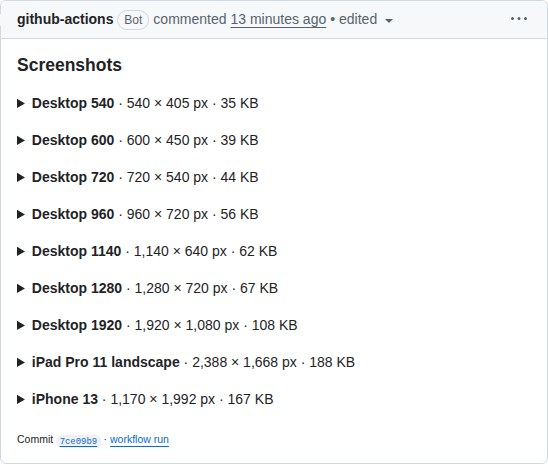
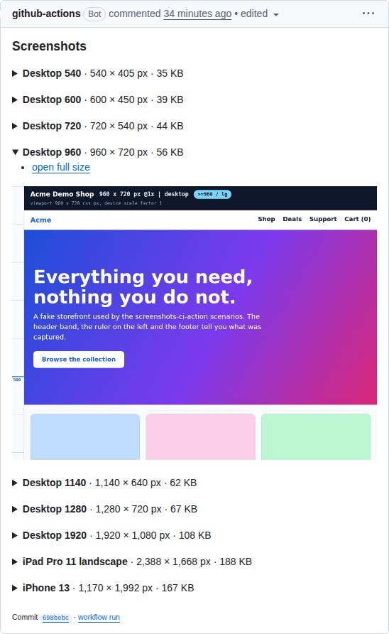

A tall page is one section with its parts **stacked** inside (they read as one
continuous page), and `comment-layout: links` posts only a list of links:

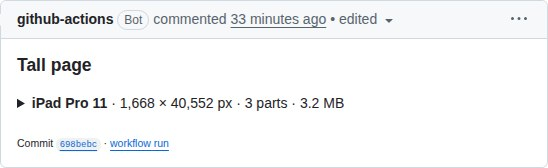
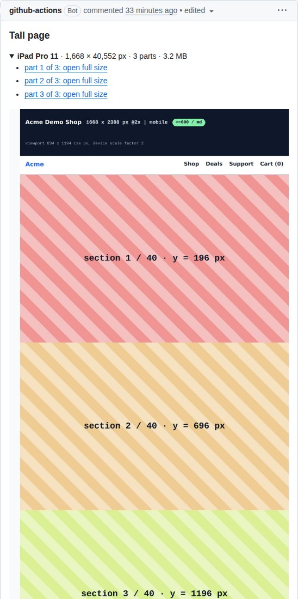
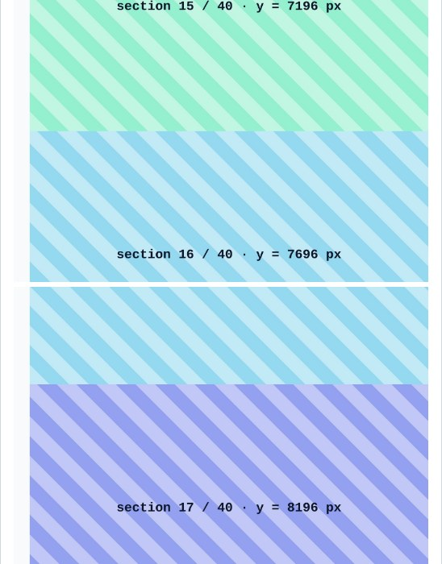
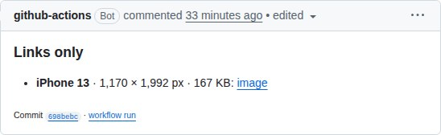

Every image carries a `width` of at most `comment-image-width` CSS pixels
(default 600) and, with the aspect ratio kept, a `height`, so the browser
reserves the space before the image arrives. GitHub rewrites an image whose
height attribute is above 2000: it cuts the height to 2000 and scales the width
down with it, so a tall part would turn into a narrow strip. Images that would be
taller than 2000 pixels at the display width (the parts of a tall page) therefore
get only the `width`; their height is known once they have loaded. The parts of
one capture always stack, one below the other in one column (a `<br>` between
them leaves a thin white line), and read as one continuous page.

**Squashed images in narrow windows.** GitHub's CSS caps an image at the width of
the comment column. In a very narrow window (a phone, a split screen) an image
that has both `width` and `height` can then be drawn squashed, because the height
stays fixed while the width shrinks. If you see that, set
`comment-image-height: none`: only the `width` is written, the images keep their
proportions, and the browser can only reserve the height after the image has
loaded, so the page may jump a little again. The default keeps both attributes,
because a page that does not jump is what the accordion is for.

```yaml
# the defaults: closed accordions, one accordion per capture
- uses: Primajin/screenshots-ci-action@v4
  with:
    url: https://www.google.com/
    release-id: 63601424
  env:
    GITHUB_TOKEN: ${{ secrets.GITHUB_TOKEN }}

# the first accordion starts open
- uses: Primajin/screenshots-ci-action@v4
  with:
    url: https://www.google.com/
    release-id: 63601424
    comment-open: first
  env:
    GITHUB_TOKEN: ${{ secrets.GITHUB_TOKEN }}
```

Other options, each added to the `with:` block of a call like the ones above:

```yaml
    # everything in a single accordion, or one accordion per image
    comment-group-by: all     # or: none

    # images directly under a heading, no accordion (like v3 did)
    comment-layout: inline

    # only a list of links, no embedded images: the lightest comment
    comment-layout: links

    # no width and height on the images
    comment-image-width: 0
```

**Update in place.** The first line of the comment is a hidden marker,
`<!-- screenshots-ci-action:<comment-tag> -->`. On the next run the action lists the
comments of the pull request (all pages), finds the one that starts with that
marker and was written by `github-actions[bot]`, by the owner of a personal
access token, or by any other bot (the login of a GitHub App cannot be looked up
with its installation token, so its comments are recognised by being a bot's and
carrying the marker), and edits the newest such comment. That way a pull request
keeps one screenshot comment that follows every push. Nothing is found: a new
comment is created. A comment that was deleted in the meantime (404): a new one
is created. Any other failure of the edit (no permission, rate limit, server
error) is logged and nothing is posted, instead of adding a duplicate on every
run. `comment-mode: new` always posts a new comment, as v3 did.

**Several calls, several comments.** Every call of the action on one pull
request that should keep its own comment needs its own `comment-tag` (and
usually a `comment-headline`):

```yaml
- uses: Primajin/screenshots-ci-action@v4
  with:
    url: https://staging.example.com/
    release-id: 63601424
    comment-tag: staging
    comment-headline: Staging
  env:
    GITHUB_TOKEN: ${{ secrets.GITHUB_TOKEN }}
- uses: Primajin/screenshots-ci-action@v4
  with:
    url: https://staging.example.com/pricing
    release-id: 63601424
    comment-tag: pricing
    comment-headline: Pricing page
  env:
    GITHUB_TOKEN: ${{ secrets.GITHUB_TOKEN }}
```

Calls with the **same** tag must not run in parallel (two jobs of a matrix, or two
pushes in a row without a `concurrency` group): both can see no comment yet and
each creates one. Give parallel jobs different tags, or use a `concurrency`
group per pull request.

**Not posting.** `comment: false` still uploads the screenshots to the release
(when `release-id` is set) and logs their URLs, but posts nothing; the files in
`screenshots/` can go to a workflow artifact as before. The upload then also
happens outside pull request events (for example on `push`), which it never did
before, because without a comment there is no pull request to wait for. With a
comment but without `release-id` nothing is uploaded or posted, and the log says
so.

**Footer.** The footer names the commit under review, which is the head commit
of the pull request. The file names of the screenshots end with the short
`GITHUB_SHA` instead, which on `pull_request` events is the merge commit of the
pull request, so the two shas differ.

**Limits and mistakes.** A comment that would exceed GitHub's 65,536 character
limit is posted with the `links` layout and a warning; if even the links are too
long the list is cut with "…and N more". An unknown value for an enum input
(`comment-layout`, `comment-open`, `comment-group-by`, `comment-image-height`,
`comment-mode`), for a switch (`comment`, `comment-footer`: use `true` or `false`)
or an invalid `comment-image-width` is logged as a warning and the default is
used. Characters of `comment-tag` other than letters, digits (of any language),
space, dot, dash and underscore are replaced with `-`, with a warning.

## Examples

Every example is a complete workflow. More are in the guides above.

### Example 1: desktop and a few devices, as an artifact

```yaml
name: screenshots ci actions
on:
  push:
    branches:
    - main # Trigger the workflow when something is pushed to main

permissions:
  contents: read

jobs:
  screenshots:
    runs-on: ubuntu-latest
    steps:
    - uses: actions/checkout@v7
    - name: screenshots-ci-action
      uses: Primajin/screenshots-ci-action@v4
      with:
        url: https://github.com
        devices: iPhone 6,iPhone 6 landscape,Nexus 7,iPad Pro 11,Galaxy S III landscape,iPad Pro 11 landscape
    - uses: actions/upload-artifact@v7 # Upload the screenshots to the Actions Artifacts
      with:
        path: screenshots
        name: Download-screenshots
```

To add the workflow: create `.github/workflows/screenshots-workflow.yml` (any
`.yml` or `.yaml` name) in your repository and commit it, see
[Workflow syntax](https://docs.github.com/en/actions/writing-workflows).

### Example 2: iPhone 6 only, without desktop

```yaml
name: screenshots ci actions
on:
  push:
    branches:
    - main

permissions:
  contents: read

jobs:
  screenshots:
    runs-on: ubuntu-latest
    steps:
    - uses: actions/checkout@v7
    - name: screenshots-ci-action
      uses: Primajin/screenshots-ci-action@v4
      with:
        url: https://github.com
        devices: iPhone 6,iPhone 6 landscape
        no-desktop: true
    - uses: actions/upload-artifact@v7
      with:
        path: screenshots
        name: Download-screenshots
```

### Example 3: two URLs in one job

- URL 1: https://www.facebook.com/ (desktop)
- URL 2: https://m.facebook.com/ (mobile, iPhone 6)

```yaml
name: screenshots ci actions
on:
  push:
    branches:
    - main

permissions:
  contents: read

jobs:
  screenshots:
    runs-on: ubuntu-latest
    steps:
    - uses: actions/checkout@v7
    - name: screenshots-desktop-facebook
      uses: Primajin/screenshots-ci-action@v4
      with:
        url: https://www.facebook.com/
    - uses: actions/upload-artifact@v7
      with:
        path: screenshots
        name: Download-desktop-screenshots # URL 1
    - run: rm ./screenshots/* # Remove the files of URL 1, upload-artifact takes the whole directory

    - name: screenshots-mobile-facebook
      uses: Primajin/screenshots-ci-action@v4
      with:
        url: https://m.facebook.com/
        devices: iPhone 6,iPhone 6 landscape
        no-desktop: true
    - uses: actions/upload-artifact@v7
      with:
        path: screenshots
        name: Download-mobile-screenshots # URL 2
```

### Example 4: a pull request comment

See [README.PR.md](README.PR.md) for the release and its id.

```yaml
name: screenshots ci actions
on:
  pull_request:
    types: [ opened, synchronize, reopened ]

permissions:
  contents: write
  pull-requests: write

jobs:
  screenshots:
    runs-on: ubuntu-latest
    steps:
    - uses: actions/checkout@v7
    - uses: Primajin/screenshots-ci-action@v4
      with:
        url: https://www.google.com/
        devices: iPhone 13
        release-id: 63601424
      env:
        GITHUB_TOKEN: ${{ secrets.GITHUB_TOKEN }}
```

### More guides

- [Post screenshots into a **PR comment**](README.PR.md)
- [Integration with **Telegram**](README.Telegram.md)
- [**Vercel** preview deployments](README.Vercel.md)
- [**Netlify** preview deployments](README.Netlify.md)
- [Run the workflow by hand](README.workflow-dispatch.md)
- [Log in or set up the page first (pre-script)](README.pre-script.md)
- [Wait for an element](README.wait-for-selector.md)

## Download screenshots

The screenshots of a run are in the **Artifacts** section at the bottom of the
run's summary page (here one artifact per scenario of this repository's CI).
Click an artifact name to download it as a zip file; the zip contains the image
files of `screenshots/`.

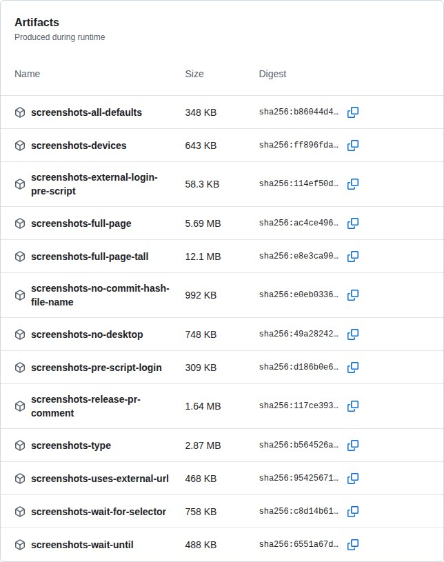

## Telegram


## Desktop sizes

Unless `no-desktop` is `true`, the page is captured at all of these viewport
sizes (device scale factor 1), one image per size:

- width: 540px, height: 405px
- width: 600px, height: 450px
- width: 720px, height: 540px
- width: 960px, height: 720px
- width: 1140px, height: 640px
- width: 1280px, height: 720px
- width: 1920px, height: 1080px

### Supported mobile devices

The `devices` input accepts any name from
[Playwright's device list](https://github.com/microsoft/playwright/blob/main/packages/isomorphic/deviceDescriptorsSource.json)
(`playwright.devices`). Pass the base name for portrait, or append
` landscape` for the landscape orientation (e.g. `iPad Pro 11 landscape`).
Separate several devices with a comma. Names are matched exactly; a name that
only differs in case is accepted. The list is kept current by upgrading
Playwright.

An **unknown device name fails the run** and the error lists close matches
("did you mean ...") together with the link above.

<details>
<summary>Base devices known to Playwright (as of Playwright 1.64; append ` landscape` for the landscape variant)</summary>

`Blackberry PlayBook`
`BlackBerry Z30`
`Galaxy Note 3`
`Galaxy Note II`
`Galaxy S III`
`Galaxy S5`
`Galaxy S8`
`Galaxy S9+`
`Galaxy S24`
`Galaxy A55`
`Galaxy Tab S4`
`Galaxy Tab S9`
`Galaxy Z Fold 6`
`Galaxy Z Fold 6 Cover`
`Galaxy Z Fold 7`
`Galaxy Z Fold 7 Cover`
`Galaxy Z Flip 6`
`Galaxy Z Flip 6 Cover`
`Galaxy Z Flip 7`
`Galaxy Z Flip 7 Cover`
`iPad (gen 5)`
`iPad (gen 6)`
`iPad (gen 7)`
`iPad (gen 11)`
`iPad Mini`
`iPad Pro 11`
`iPhone 6`
`iPhone 6 Plus`
`iPhone 7`
`iPhone 7 Plus`
`iPhone 8`
`iPhone 8 Plus`
`iPhone SE`
`iPhone SE (3rd gen)`
`iPhone X`
`iPhone XR`
`iPhone 11`
`iPhone 11 Pro`
`iPhone 11 Pro Max`
`iPhone 12`
`iPhone 12 Pro`
`iPhone 12 Pro Max`
`iPhone 12 Mini`
`iPhone 13`
`iPhone 13 Pro`
`iPhone 13 Pro Max`
`iPhone 13 Mini`
`iPhone 14`
`iPhone 14 Plus`
`iPhone 14 Pro`
`iPhone 14 Pro Max`
`iPhone 15`
`iPhone 15 Plus`
`iPhone 15 Pro`
`iPhone 15 Pro Max`
`iPhone 16`
`iPhone 16 Plus`
`iPhone 16 Pro`
`iPhone 16 Pro Max`
`iPhone 16e`
`iPhone 17`
`iPhone Air`
`iPhone 17 Pro`
`iPhone 17 Pro Max`
`iPhone 17e`
`Kindle Fire HDX`
`LG Optimus L70`
`Microsoft Lumia 550`
`Microsoft Lumia 950`
`Nexus 10`
`Nexus 4`
`Nexus 5`
`Nexus 5X`
`Nexus 6`
`Nexus 6P`
`Nexus 7`
`Nokia Lumia 520`
`Nokia N9`
`Pixel 2`
`Pixel 2 XL`
`Pixel 3`
`Pixel 4`
`Pixel 4a (5G)`
`Pixel 5`
`Pixel 6`
`Pixel 6 Pro`
`Pixel 6a`
`Pixel 7`
`Pixel 7 Pro`
`Pixel 7a`
`Pixel 8`
`Pixel 8 Pro`
`Pixel 8a`
`Pixel 9`
`Pixel 9 Pro`
`Pixel 9 Pro XL`
`Pixel 10`
`Pixel 10 Pro`
`Pixel 10 Pro XL`
`Moto G4`
`Desktop Chrome HiDPI`
`Desktop Edge HiDPI`
`Desktop Firefox HiDPI`
`Desktop Safari`
`Desktop Chrome`
`Desktop Edge`
`Desktop Firefox`

The `Desktop ...` entries are desktop browser profiles. The action always
renders with Chromium, so the Firefox and Safari ones only change the
viewport, user agent and scale factor.

</details>

## Migrating from v3

v4 replaces Puppeteer with Playwright. Outputs are the same kind of files, but
six things can change in an existing workflow. What v4 adds on top is in
[What v4 does that v3 could not](#what-v4-does-that-v3-could-not).

1. **Input names are now kebab-case**, matching the GitHub Actions convention.
   The old camelCase names are **not** accepted any more; GitHub only prints an
   `Unexpected input(s)` warning for them and the values are silently ignored,
   so rename them in your workflow. `url`, `devices` and `type` are unchanged.

   | v3 input | v4 input |
   | --- | --- |
   | `noDesktop` | `no-desktop` |
   | `fullPage` | `full-page` |
   | `noCommitHashFileName` | `no-commit-hash-file-name` |
   | `waitUntil` | `wait-until` |
   | `waitForSelector` | `wait-for-selector` |
   | `waitForSelectorHidden` | `wait-for-selector-hidden` |
   | `waitForSelectorVisible` | `wait-for-selector-visible` |
   | `waitForSelectorTimeout` | `wait-for-selector-timeout` |
   | `releaseId` | `release-id` |
   | `preScriptPath` | `pre-script-path` |
   | `preScriptTimeout` | `pre-script-timeout` |

   (`preScriptPath` and `preScriptTimeout` were added after v3; they only
   exist in the kebab-case form in any released version.)
2. **Device names** now come from Playwright's list (see the table below). An
   unknown name now **fails the run** with "did you mean" suggestions instead
   of being logged and skipped.
3. **`wait-until`**: `networkidle0` and `networkidle2` are still accepted but
   both map to Playwright's single `networkidle`. The default is now
   `networkidle`. `commit` is new. Playwright's `networkidle` waits for **no**
   network connection for 500 ms, whereas `networkidle2` allowed up to two. A page
   that settled under `networkidle2` but keeps one or two connections open (long
   polling, websockets, analytics beacons) may now never settle: the navigation
   hits its 30 second timeout, and a navigation timeout **fails the run**. Switch
   such pages to `wait-until: load` or `domcontentloaded` (add `wait-for-selector`
   if you need a specific element).
4. **Composite action**: the action installs its own dependencies and Chromium
   (`npx playwright install --with-deps chromium`) instead of running a bundled
   `dist/` on the Node runtime. You no longer need a Chrome/puppeteer install
   step (e.g. `mujo-code/puppeteer-headful`) in your workflow, and
   `PUPPETEER_EXECUTABLE_PATH` / `CHROME_BIN` are no longer honoured.
5. **The PR comment is updated in place** (behaviour change). v3 posted a new
   comment with plain `` tags for every push. v4 keeps one comment per
   `comment-tag` and edits it on the next push, with a closed `<details>` section
   per capture. To get close to the v3 comment use `comment-mode: new`,
   `comment-layout: inline`, `comment-image-width: 0` and `comment-footer: false`
   (the headline and the hidden marker line remain, and the headings show a
   readable name instead of the asset name); see
   [PR comments](#pr-comments). Several calls of the action on one pull request
   now need different `comment-tag`s, or they overwrite each other's comment.
6. **Tall full page captures are split into parts (breaking for name based
   consumers).** `full-page: true` now first scrolls through the page
   (`scroll-before-capture`, on by default), and a page taller than
   `max-image-height` (default `16000` output pixels) is written as
   `<name>-part1-<sha>.jpeg`, `-part2`, ... instead of one `<name>-<sha>.jpeg`.
   Anything that matches the old single file by name (a script, an artifact
   path, an upload step) finds nothing for tall pages. The files that fit keep
   their name. Details: [Tall pages](#tall-pages).

Also new: `wait-for-selector-timeout: 0` now really disables the timeout (it used
to fall back to 30 seconds) and `release-id` is a declared input.

### Migrating device names from the Puppeteer based versions (v3 and earlier)

Playwright's list differs from Puppeteer's `KnownDevices`. All other devices of
the v3 list exist in Playwright's list under the same name (checked against
Playwright 1.64):

| Puppeteer name (removed) | Use instead |
| ------------- | ------------- |
| `iPad` | `iPad (gen 5)`, `iPad (gen 6)`, `iPad (gen 7)` or `iPad (gen 11)` |
| `iPad Pro` | `iPad Pro 11` |
| `iPhone 4`, `iPhone 5` | no equivalent, closest is `iPhone 6` |
| `JioPhone 2` | no equivalent |

Playwright additionally knows many newer devices (iPhone 16/17 family, Pixel
6-10, Galaxy S24, Galaxy Z Fold/Flip, ...) and the `Desktop Chrome`,
`Desktop Edge`, `Desktop Firefox` and `Desktop Safari` profiles. Names that
exist in both lists (for example `iPhone 13`, `Pixel 5`, `Galaxy S III`) keep
working, but their emulated viewport/user agent may differ slightly between
Puppeteer's and Playwright's data. Each device is rendered in its own browser
context.

## Development

The action is plain ES modules on Node 24 or newer, linted with [xo](https://github.com/xojs/xo)
and tested with [Vitest](https://vitest.dev/).

```bash
npm ci
npm run lint        # xo (npm run lint:fix to auto-fix)
npm test            # unit tests (vitest run), no browser or network needed
npm run coverage    # unit tests with coverage
```

- **Layout.** `action.yml` is a composite action: it installs the npm
  dependencies and Chromium, then runs `index.js`. `capture.js` (scrolling,
  tall pages), `comment.js`, `comment-options.js` and `pr-comment.js` (the PR
  comment), `telegram.js`, `pre-script.js`, `image-size.js` and `utils.js` hold
  the rest; every module has a `*.test.js` next to it.
- **Scenarios.** Every option has a self-test: a reusable workflow
  `.github/workflows/_pass_<scenario>.yml` (or `_fail_...`) that runs the action
  against a local fixture site and asserts on the images. They run on every pull
  request. See [README.ci.md](README.ci.md) for the list, how to add one and
  **how to run the action on your own machine with Playwright**.
- **Commits and releases.** Pull request titles follow
  [Conventional Commits](https://www.conventionalcommits.org/) (`feat:`, `fix:`,
  `docs:`, `feat!:` for a breaking change);
  [release-please](https://github.com/googleapis/release-please) turns them into
  the changelog and the version, and moves the major tag (`v4`) after a release.
- **Changing an input** means changing `action.yml`, the matching env line in its
  `Take screenshots` step, `index.js`, and the Inputs tables above in the same
  pull request.

## Result examples

### desktop (600x450)
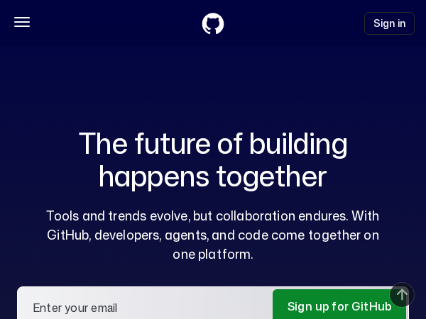

### desktop (960x720)
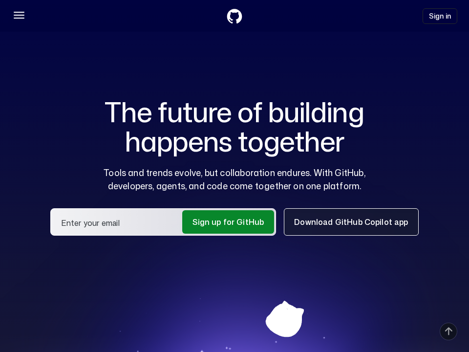

### desktop (1140x640)
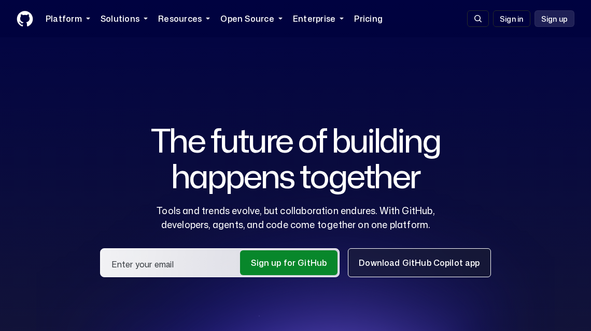

### desktop (1920x1080)
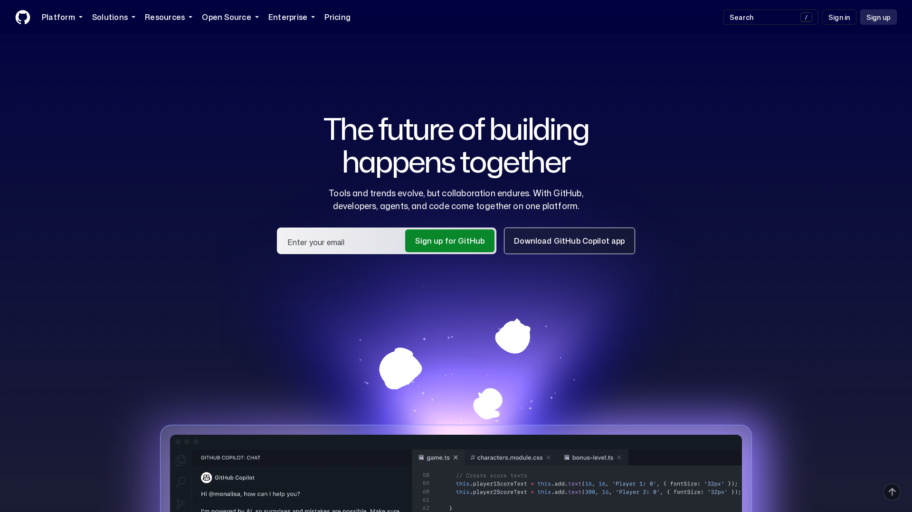

### mobile (iPhone_6_landscape)
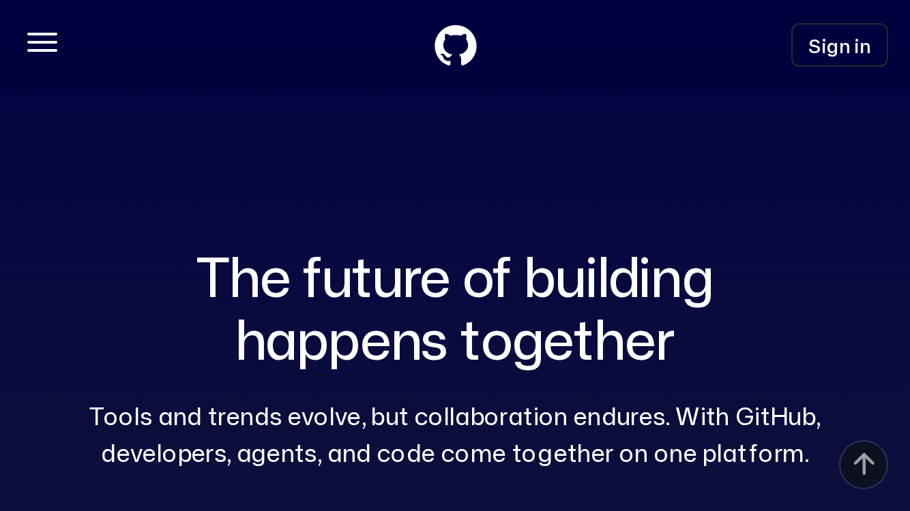

### mobile (iPhone_6)
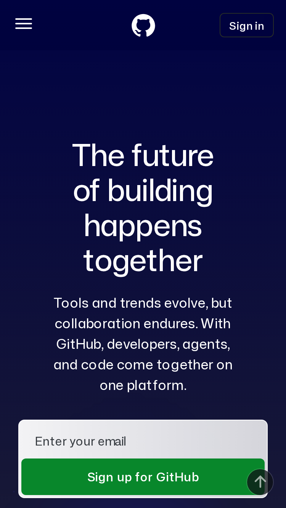

### mobile (Nexus_7)
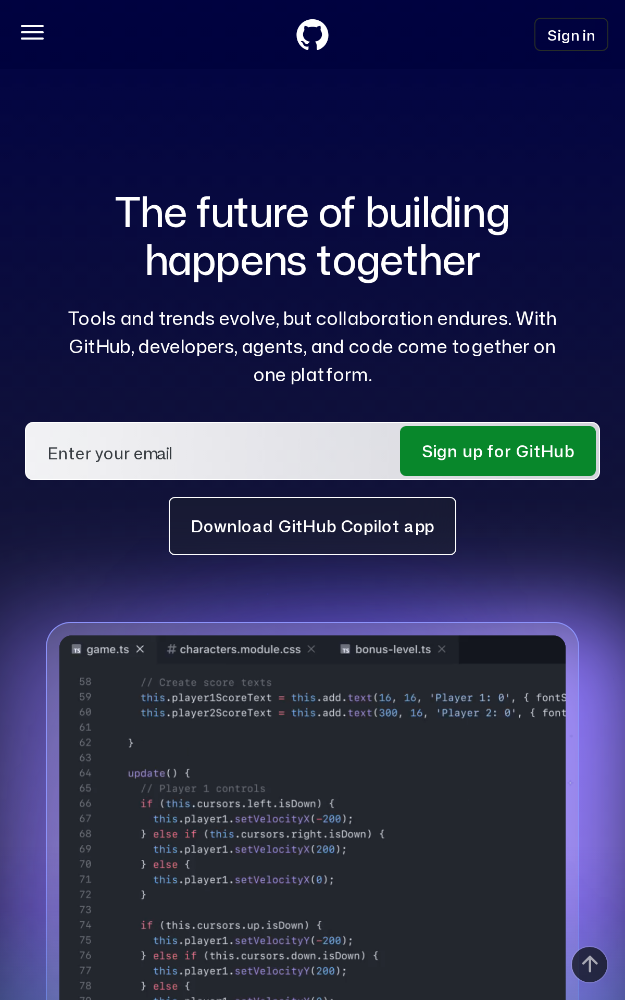

### mobile (iPhone_6, full-page)
github.com is 27,560 px tall on an iPhone 6 (2x), above the 16,000 px limit of
one image, so the capture is two parts (`iPhone_6-part1-9890851.jpeg` and
`iPhone_6-part2-9890851.jpeg`), shown here side by side (see
[Tall pages](#tall-pages)):

<p align="center">
  
  
</p>
