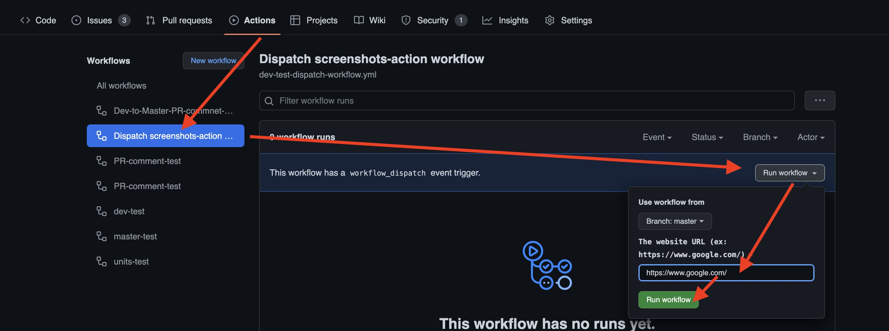

# Run the workflow by hand (workflow_dispatch)

[Back to the README](README.md)

`workflow_dispatch` adds a **Run workflow** button to the Actions tab where you
type the inputs yourself: handy to screenshot any URL on demand. The workflow
file must be on the default branch for the button to appear.

## 1. Add the workflow

```yaml
name: Dispatch screenshots-action workflow
on:
  workflow_dispatch:
    inputs:
      url:
        description: 'The website URL (ex: https://www.google.com/)'
        required: true
        default: ''

permissions:
  contents: read

jobs:
  screenshots:
    runs-on: ubuntu-latest
    steps:
    - uses: actions/checkout@v7
    - name: screenshots-ci-action
      uses: Primajin/screenshots-ci-action@v4
      with:
        url: ${{ inputs.url }}
    - uses: actions/upload-artifact@v7
      with:
        path: screenshots
        name: Download-screenshots
```

## 2. Go to the Actions page and run it

Pick the workflow in the left list, press **Run workflow**, fill in the form and
start it. The screenshots are in the **Artifacts** section of the run.



## More examples

A URL and mobile devices (generates the desktop and the mobile screenshots):

```yaml
name: Dispatch screenshots-action workflow
on:
  workflow_dispatch:
    inputs:
      url:
        description: 'The website URL (ex: https://www.google.com/)'
        required: true
        default: ''
      devices:
        description: 'Mobile devices, separated by commas (ex: iPhone 13,Pixel 7). Empty: desktop only'
        required: false
        default: ''

permissions:
  contents: read

jobs:
  screenshots:
    runs-on: ubuntu-latest
    steps:
    - uses: actions/checkout@v7
    - name: screenshots-ci-action
      uses: Primajin/screenshots-ci-action@v4
      with:
        url: ${{ inputs.url }}
        devices: ${{ inputs.devices }}
    - uses: actions/upload-artifact@v7
      with:
        path: screenshots
        name: Download-screenshots
```

Two URLs in one run (every call writes into `screenshots/`, so the first
call's files are removed before the second call):

```yaml
name: Dispatch screenshots-action workflow
on:
  workflow_dispatch:
    inputs:
      url1:
        description: 'The website URL (ex: https://www.google.com/)'
        required: true
        default: ''
      url2:
        description: 'The website URL (ex: https://stackoverflow.com/)'
        required: true
        default: ''

permissions:
  contents: read

jobs:
  screenshots:
    runs-on: ubuntu-latest
    steps:
    - uses: actions/checkout@v7
    - name: screenshots-url1-action
      uses: Primajin/screenshots-ci-action@v4
      with:
        url: ${{ inputs.url1 }}
    - uses: actions/upload-artifact@v7
      with:
        path: screenshots
        name: Download-url1-screenshots
    - run: rm ./screenshots/*

    - name: screenshots-url2-action
      uses: Primajin/screenshots-ci-action@v4
      with:
        url: ${{ inputs.url2 }}
        devices: iPhone 6,iPhone 6 landscape
        no-desktop: true
    - uses: actions/upload-artifact@v7
      with:
        path: screenshots
        name: Download-url2-screenshots
```
